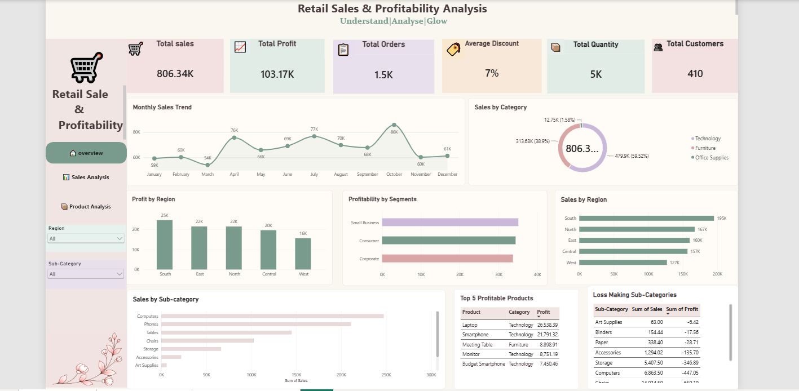
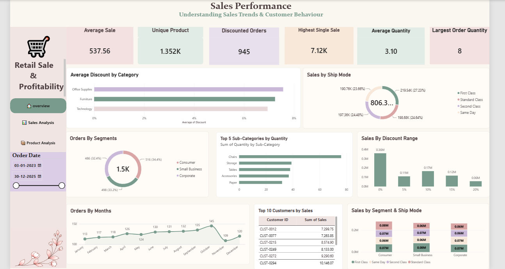
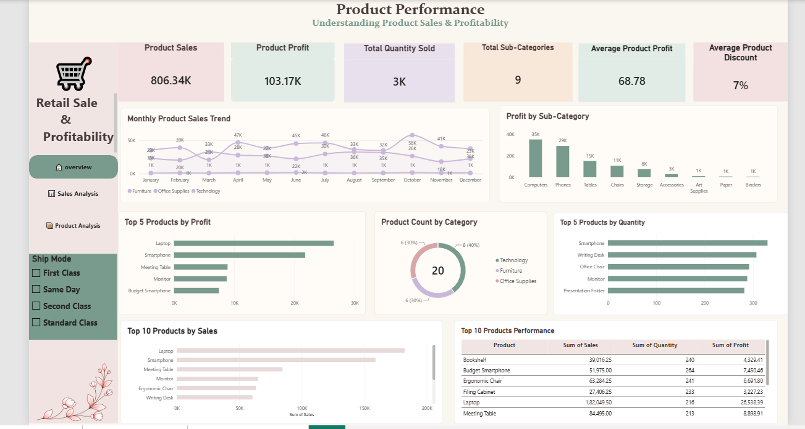

# Retail Sales & Profitability Analysis

## Project Overview
Retail Sales & Profitability Analysis is a data analytics project developed using Microsoft Power BI. The project focuses on analyzing retail sales data to understand sales trends, product performance, customer behaviour, and business profitability through interactive dashboards.

## Problem Statement
Retail businesses generate large amounts of sales data, but understanding this data and identifying meaningful patterns can be challenging. This project aims to transform retail sales data into meaningful insights that can support better business understanding and decision-making.

## Project Objectives
- Analyze overall sales and profit performance.
- Understand monthly sales trends.
- Identify top-performing products and sub-categories.
- Compare sales across different regions and customer segments.
- Analyze shipping modes and discount patterns.
- Present insights through interactive dashboards.

## Tools & Technologies
- Microsoft Power BI
- Power Query (cleaned dataset used for analysis)
- Data Visualization
- Data Analysis

## Dashboard Pages

### 1. Overview
Provides a summary of overall retail sales and profitability through KPI cards, monthly sales trends, category analysis, regional performance, and product profitability.

### 2. Sales Analysis
Focuses on sales performance, monthly order trends, shipping modes, customer sales, discount patterns, and segment-wise analysis.

### 3. Product Analysis
Highlights product performance through product sales, product profit, quantity analysis, sub-category performance, and top-performing products.

## Dashboard Screenshots

### 1. Overview Dashboard

### 2. Sales Analysis Dashboard

### 3. Product Analysis Dashboard

## Key Insights
The dashboards help explore:
- Monthly sales and order trends.
- Differences in product and sub-category performance.
- Sales contribution across customer segments and shipping modes.
- Regional sales and profitability patterns.
- Products contributing to higher sales and profit.

## Project File
The Power BI project file is available in this repository as `project.pbix`.

Download the file and open it using Microsoft Power BI Desktop to explore the interactive dashboard.

## Conclusion
This project demonstrates how Power BI can be used to transform retail sales data into interactive visual reports and meaningful business insights.

